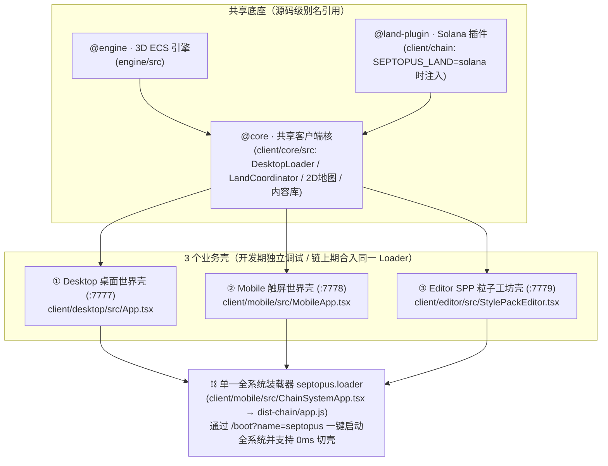
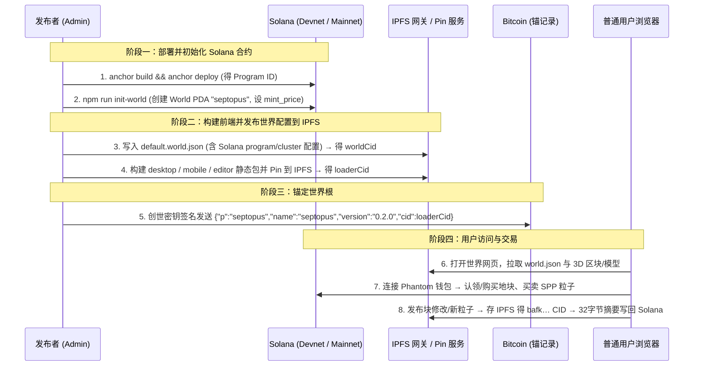

# Septopus World · 公众版（3D 浏览 + 土地交易 + SPP 粒子市场）上线评估与部署方案

> **目标**：面向普通用户发布首个可公开访问、可链上交易的混合架构版本——支持 **3D 世界漫游与交互**、**Solana 土地认领/买卖/内容发布**、**SPP 弦粒子（StylePack / 组合件 Prefab）创作与市场流通**。
> **关联规范**：[`protocol/cn/boot-chain.md`](../../protocol/cn/boot-chain.md)（比特币锚启动链） · [`protocol/cn/land.md`](../../protocol/cn/land.md)（Solana 产权注册表） · [`docs/plan/specs/spp-editors.md`](specs/spp-editors.md)（SPP 双编辑器） · [`deploy/RELEASE.md`](../../deploy/RELEASE.md)（版本发布流）。

---

## 1. 客户端矩阵：需要几个 Client？

结论：**开发期保留 3 个独立前端壳（`:7777` 桌面、`:7778` 移动、`:7779` 粒子工坊），而在链上发布时，已实现由单个 `septopus.loader`（`ChainSystemApp`）一次性装载整个系统（移动端 3D 世界 + 桌面端 3D 世界 + SPP 粒子工坊 + Solana 土地合约与市场）！**



| 形态 | 入口与地址 | 目标用户 | 承担的核心职责 | 构建与发布命令 |
|---|---|---|---|---|
| **⚡ 全系统单一 Loader（推荐主入口）**<br>[`ChainSystemApp.tsx`](../../client/mobile/src/ChainSystemApp.tsx) | `:7789/boot?name=septopus`<br>（可选 `&shell=mobile\|desktop\|editor`） | 所有用户（零应用服务器依赖，纯 BIOS shim + IPFS CAS + 链） | **一个 `septopus.loader` 文档装入全部子系统**：底部内置 `📱 触屏` / `🖥 桌面` / `🧬 粒子工坊` 切换栏；触屏与桌面共享同一个 `#three_demo` WebGL 实例（**0ms 无缝热切**，保持坐标、钱包与区块状态），粒子工坊发布的 `StylePack` CID 直接写入 IPFS 网关并实时同步回 3D 世界沙盘，且双端均内置 Solana `LandPanel` | `bash deploy/publish-chain.sh`<br>（自动带 `SEPTOPUS_LAND=solana` 打包单文件 IIFE 并重播种锚） |
| **① 桌面世界端（独立壳）**<br>`client/desktop` | `:7777` | 桌面玩家、地主、空间搭建者 | 键鼠 3D 漫游、小游戏、2D 地图、**土地认领/挂单/购买（`LandPanel`）**、块内「SPP 魔法球（Editor 1）」与 Adjunct 工具箱搭建并一键发布 CID 上链 | `npm run build`（纯引擎）<br>`npm run build:chain`（含 Solana） |
| **② 移动世界端（独立壳）**<br>`client/mobile` | `:7778` | 手机触屏玩家 | 虚拟摇杆 + 触屏 3D 浏览、角落徽章开地图/背包/化身、右侧十字动作盘、移动端块编辑与 `LandPanel` | `npm run build` |
| **③ SPP 粒子工坊（独立壳）**<br>`client/editor` | `:7779` | 粒子设计师、3D 资产创作者 | 6 面通/挡变体池与独立组合件（`prefabs`）编辑、3D 坍缩盘实时预览、`OptionGuard` 契约守卫、一键打包生成 CID 并写入 IPFS | `npm run build` |

> **为什么不把粒子市场单独拆成第 4 个网站？**
> - **买粒子、用粒子**发生在世界里（地主在 `client/desktop` 的 SPP 魔法球里切风格包/摆组合件时，直接预览并解锁购买最顺畅）；
> - **造粒子、发粒子**发生在 `client/editor`（造完直接点「Publish CID → 上架定价」一步到位）。拆成第 4 个壳反而割裂了 3D 实时预览能力。

---

## 2. 功能就绪度与缺失清单（Gap Analysis）

### 2.1 三大核心场景盘点

| 模块 | 已就绪（✅ 代码已落地并经过测试） | 待补齐缺失项（🔲 上线前必做 / ⏸️ 可二期迭代） |
|---|---|---|
| **A. 3D 浏览与漫游** | ✅ 默认展厅走廊（`gallery` 21 块铺装环境 + 传送门）、仙剑余杭客栈合院、星际人族基地群、过山车、跑酷、3D 麻将/台球/射击<br>✅ 5 种模式（Normal / Ghost / Observe / Edit / Game）、昼夜与比特币区块日历时钟、程序化 GLB 资产管线<br>✅ 桌面键鼠 + 移动虚拟摇杆双端可用 | 🔲 **P0 新手引导浮层（Onboarding）**：普通用户首次进入不知道 `WASD`/鼠标锁视角/点传送门/开地图，需加一个 10 秒可关闭的首次操作提示卡<br>🔲 **P1 快捷世界导航栏**：在顶部或地图提供「热门地标 / 在售地块 / 示范展区」一键传送列表 |
| **B. 土地购买与产权**<br>（Solana `septopus_land`） | ✅ Solana 合约 `init_world` / `mint_block` / `set_content` / `list_block` / `delist_block` / `buy_block` / `transfer_block` / `moderate_block`<br>✅ 32 字节 CIDv1(`bafk…`) 摘要上链 + IPFS 内容拉取重渲染<br>✅ `LandPanel`（连接钱包、当前脚下地块认领、发布 3D 修改上链、挂单、购买）<br>✅ 非所有者禁止进入 `Edit` 模式门控 | 🔲 **P0 2D 地图选地与交易联动（核心缺失）**：目前用户必须「走到/瞬移到某块地」才能在左上角 `LandPanel` 看到状态并购买；需在 `WorldMap2D.tsx` 和 `BlockDetailPage.tsx` 接入 `LandCoordinator`，**在 2D 地图上按颜色高亮「已认领 / 在售（标价）/ 我的地块」，点任意格子直接在详情页认领或购买**<br>🔲 **P0 钱包选择器与主网护栏**：目前自动探测 `window.solana`（Phantom/Solflare）或回退本地测试钱包；上线需加明确的钱包安装引导提示，且在 `mainnet-beta`/`devnet` 下禁用本地 Burner 按钮<br>🔲 **P1 生产级 IPFS 写入鉴权**：开发网关 `services/ipfs` 的 `POST /v0/add` 无鉴权；公网部署需对接 Pinata/Web3.Storage 或为自建网关加签名/大小限流（防恶意刷盘） |
| **C. SPP 粒子市场**<br>（StylePack & Prefab） | ✅ SPP 完整协议：`StylePack`（open/closed 面变体池，支持任意 adjunct 组合）+ `prefabs`（独立组合件 `pack#key`）<br>✅ 粒子工坊 `client/editor`：可视化编辑、契约守卫 `OptionGuard`、导出 JSON、生成真实 CID<br>✅ 世界内「SPP 魔法球」实时切换风格包与面造型 | 🔲 **P0 链上粒子注册与市场指令（核心缺失）**：目前 `septopus_land` 合约只管 `Block`，**还没有 `StylePack / Prefab` 的链上注册与售卖账户**。需在合约新增 `ParticleItem` PDA（存创作者、CID 摘要、类型 `stylepack\|prefab`、单价、版税/买断策略、销量）及 `publish_particle` / `buy_particle` 指令<br>🔲 **P0 粒子市场 UI（工坊上架 + 世界内选购）**：<br>  1) 在 `client/editor` 右上角把「Publish CID」升级为「发布到 IPFS 并上架 Solana 市场（设价格 SOL）」；<br>  2) 在 `client/desktop` 的 SPP 魔法球工具栏增加「🛒 粒子市场」抽屉，拉取链上已发布的 StylePack/Prefab 列表，支持 3D 试穿预览、购买（或免费订阅引用）并写入自己的地块 |

---

### 2.2 上线前必做工作量汇总（按优先级）

1. **【P0 · 约 1~2 天】Solana 合约扩展 SPP 粒子市场（`Particle` 账户与指令）**
   - 在 [`chain/programs/septopus_land/src/lib.rs`](../../chain/programs/septopus_land/src/lib.rs) 中增加粒子市场 PDA：
     - `Particle` 账户：`creator: Pubkey` · `content: [u8; 32]`（StylePack/Prefab JSON 的 CIDv1 摘要）· `kind: u8`（0=StylePack, 1=Prefab）· `price: u64`（0=免费开源，>0=付费使用/购买）· `sales: u64` · `status: u8`。
     - `License`（或购买凭证 PDA `["license", particle_pda, buyer]`）：记录某钱包已购买某付费粒子库。
     - 指令：`register_particle`、`update_particle_price`、`buy_particle`。
2. **【P0 · 约 1 天】2D 地图（`WorldMap2D` + `BlockDetailPage`）打通土地状态与直接购买**
   - 地图视口批量调用 `loader.land.syncCoords()`，用颜色区分：灰色=未认领、青色=已认领、金色描边=挂单在售、绿色=我的地块。
   - 点击地图格子弹出的 `BlockDetailPage` 直接展示所有者、价格，并提供「⛏ 认领」「💎 购买」「⟡ 传送过去」按钮。
3. **【P0 · 约 1~2 天】`client/editor` 上架闭环 + `client/desktop` 粒子市场面板**
   - `client/editor` 接入 `@land-plugin`，创作者点「上架市场」自动 `POST /v0/add` 到 IPFS 网关 + 调合约 `register_particle`。
   - `client/desktop` 的 SPP 沙盘栏新增「🛒 粒子市场」弹窗，从合约拉取 `Particle` 账户列表，点选即可加载对应 CID 的 `StylePack` 实时预览与购买。
4. **【P1 · 约 0.5 天】首次进入的操作引导卡 + IPFS 上传接口限流（单文件 ≤ 2MB + 钱包签名校验）**。

---

## 3. 链上部分与基础设施如何部署？

混合架构下，链上与存储分为 **3 个独立部分**：**① IPFS 内容层**、**② Solana 产权与市场合约层**、**③ Bitcoin 世界根锚定层**。建议**先上 Solana Devnet + 公网 IPFS 网关做公测，稳定后切 Mainnet**。



### 3.1 第一步：部署 Solana 合约（`septopus_land`）

> **建议节奏**：先部署到 **Solana Devnet**（零真金白银成本，Phantom 钱包切到 Devnet 即可体验全部买地、挂单、买粒子流程）；公测无误后用同一套命令切 `mainnet-beta`。

```bash
# 1. 选择目标网络（以 devnet 为例；主网改为 mainnet-beta）
solana config set --url https://api.devnet.solana.com

# 2. 准备部署者/世界领主密钥（确保账户有 ~2.5 SOL 用于合约部署租金）
solana-keygen pubkey chain/keys/world-authority.json
solana airdrop 2 $(solana-keygen pubkey chain/keys/world-authority.json)   # devnet 领水

# 3. 编译并部署合约（Program ID 由 chain/keys/septopus_land-keypair.json 固定）
cd chain
anchor build
solana program deploy target/deploy/septopus_land.so \
  --program-id keys/septopus_land-keypair.json \
  --keypair keys/world-authority.json \
  --with-compute-unit-price 10000

# 4. 在链上初始化 "septopus" 世界账户（设置 4096×4096 边界与初始认领价 0.1 SOL）
cd ../client/chain
SOLANA_RPC=https://api.devnet.solana.com \
WORLD_NAME=septopus \
MINT_PRICE=100000000 \
npm run init-world
```

**合约升级与维护**：
- 只要保留 `chain/keys/world-authority.json`（Upgrade Authority），后续扩充粒子市场指令后执行 `solana program deploy` 即可原地升级合约逻辑，已铸造的 `World` 与 `Block` PDA 数据完全保留。
- 正式上主网稳定后，可通过 `solana program set-upgrade-authority <PROGRAM_ID> --final` 放弃升级权实现完全不可篡改，或移交多签钱包（Squads）。

---

### 3.2 第二步：部署 IPFS 内容网关与静态前端

用户发布的地块 JSON（几 KB）和 SPP 粒子包（几 KB）通过 `POST /v0/add` 写入 IPFS，全网其他玩家通过 `/ipfs/<cid>` 读取（客户端内建 sha2-256 重哈希校验，网关不可作恶）。

1. **轻量自建方案（推荐起步，零第三方依赖）**：
   - 直接在云服务器运行仓库自带的 [`services/ipfs/server.ts`](../../services/ipfs/server.ts)（Node 进程，数据落盘在 `services/ipfs/data/blobs/<cid>`），用 Nginx/Caddy 反代到 `https://ipfs.septopus.xyz`。
   - 同时配置环境变量 `VITE_IPFS_GATEWAYS=https://ipfs.io,https://dweb.link` 作为公网只读兜底。
2. **三端静态构建与托管（Cloudflare Pages / GitHub Pages / Nginx 均可）**：
   ```bash
   # 更新 client/core/src/worlds/default.world.json 中的 land.cluster ("devnet" 或 "mainnet-beta")

   # 1) 构建含链桌面端 (→ client/desktop/dist-chain)
   cd client/desktop && VITE_IPFS_GATEWAY=https://ipfs.septopus.xyz npm run build:chain

   # 2) 构建含链移动端 (→ client/mobile/dist)
   cd ../mobile && SEPTOPUS_LAND=solana VITE_IPFS_GATEWAY=https://ipfs.septopus.xyz npm run build

   # 3) 构建 SPP 粒子工坊 (→ client/editor/dist)
   cd ../editor && npm run build
   ```

---

### 3.3 第三步：发布比特币锚（全链启动根）

当世界配置（包含 Solana 合约地址 `land.program`）和客户端链包准备好后，按 [`protocol/cn/boot-chain.md §7`](../../protocol/cn/boot-chain.md) 锚定版本：

```bash
# 1. 本地/网关预演：打包 mobile IIFE 并生成 septopus.loader 文档与 ROOT_CID
GW=https://ipfs.septopus.xyz bash deploy/publish-chain.sh
# 输出示例：
#   ROOT_CID(loader) bafkrei...
#   锚记录            {"p":"septopus","name":"septopus","version":"0.2.0","cid":"bafkrei..."}

# 2. 主网锚定：用创世比特币密钥将上述单行 JSON 铭刻（Ordinals inscription 或 OP_RETURN）上链。
```

- 在未接真比特币索引器的过渡期，网关自身的 `/v0/name/anchor:septopus` 名字索引即作为符合 `boot-chain.md §5` 的标准替身，浏览器打开 `https://ipfs.septopus.xyz/boot?name=septopus` 即可体验完整全链启动流程。
